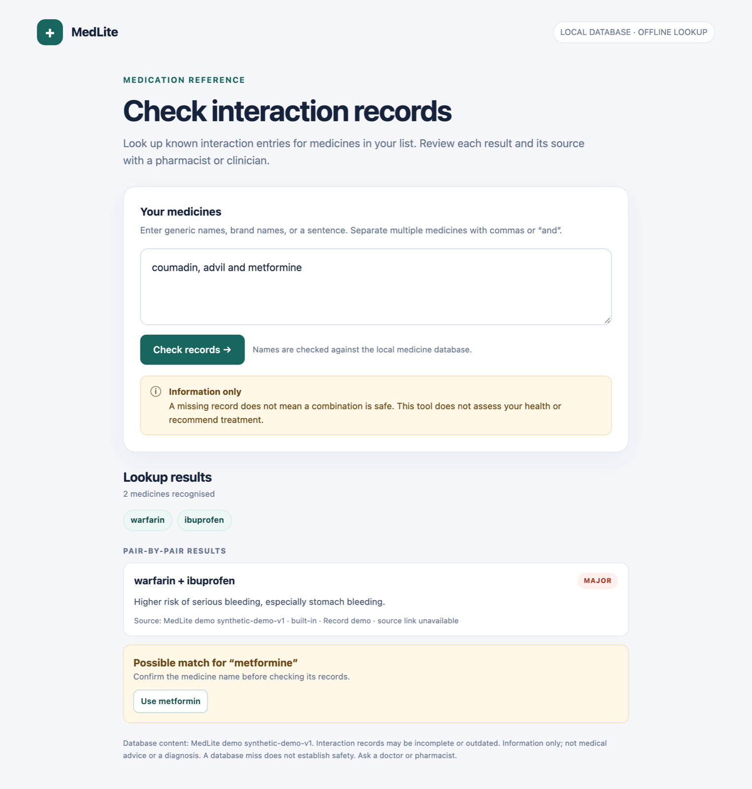
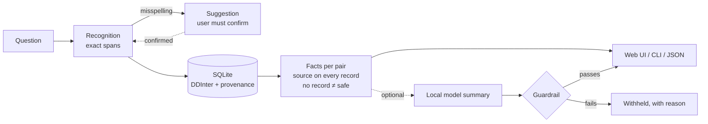

<div align="center">

# MedLite

**Offline drug-interaction lookup where the database, not the model, is the source of truth.**

[](https://github.com/kushagragupta2005/MedLite/actions/workflows/tests.yml)
[](LICENSE)
[](pyproject.toml)
[](pyproject.toml)
[](https://ddinter.scbdd.com/terms/)

[Quick start](#quick-start) · [How it works](#how-it-works) · [Guardrail](#llm-guardrail) · [Evaluation](#evaluation) · [Research notes](docs/RESEARCH_NOTES.md)

</div>

> [!WARNING]
> **Information tool only, not medical advice.** A missing record never means a combination is safe. Ask a doctor or pharmacist.

<p align="center">
  <picture>
    <source media="(prefers-color-scheme: dark)" srcset="docs/screenshots/web-ui-dark.png">
    
  </picture>
</p>

## Overview

People taking several medicines need a quick, trustworthy way to check whether any of them interact. A general chatbot can invent an interaction, or miss one. MedLite answers only from a curated interaction database: every result names its source record, every requested pair gets a result, and a pair with no record is reported as *unknown*, never as *safe*.

An optional small local model can rephrase the database facts in plain language. It never decides what is looked up or how severe an interaction is, and its output is checked before it is shown.

## Features

- **Database as source of truth.** [DDInter](https://ddinter.scbdd.com/) exports are imported into SQLite with file-level provenance: SHA-256, release label and DDInter record IDs on every interaction. The author's local snapshot holds 160,235 unique drug pairs and 1,939 drugs in a 14 MB indexed database.
- **Recognises how people actually write.** Generic names, brand names (Crocin, Advil, Coumadin…), free-text sentences, and names with punctuation such as `anti-inhibitor coagulant complex` or `amphotericin b (liposomal)`.
- **Spelling help that never guesses silently.** A misspelling produces suggestions, and nothing is looked up until the user confirms one.
- **Pair-by-pair results.** Every combination is reported, most severe first, with the source record for each.
- **Guarded plain-language summaries** from a local model through [Ollama](https://ollama.com) (optional; default `qwen2.5:0.5b`).
- **Private by default.** Binds to `127.0.0.1`, keeps request logging off, and stores raw questions only if `MEDLITE_LOG_QUERIES=1` is set.
- **No dependencies.** Standard-library Python 3.9+, a single command-line tool and a small web UI with light and dark themes.

## Quick start

No licensed data is needed for a first look. `init` creates a small demo database.

```sh
git clone https://github.com/kushagragupta2005/MedLite.git
cd MedLite
python3 -m medlite init                                    # demo data -> baseline/med.db
python3 -m medlite ask "can I take coumadin with advil?"
python3 -m medlite serve                                   # web UI at http://127.0.0.1:8000
```

To use the real data, download the DDInter CSVs from <https://ddinter.scbdd.com/download/> (CC BY-NC-SA 4.0) and import them:

```sh
python3 -m medlite load data/ddinter_downloads_code_A.csv --release local-export-YYYY-MM-DD
python3 -m medlite stats
```

| Option | Effect |
|---|---|
| `--db PATH` or `MEDLITE_DB` | Choose the database |
| `ask --llm`, `serve --llm` | Add the guarded plain-language summary (needs `ollama serve`) |
| `--exact` | Turn off spelling suggestions |
| `serve --port N` | Change the port |
| `MEDLITE_MODEL`, `MEDLITE_OLLAMA_URL` | Configure the local model |

`pip install .` also provides a `medlite` command. The older entry point `python3 baseline/med.py <command>` still works and runs the same code.

## How it works



| Module | Responsibility |
|---|---|
| [`medlite/recognition.py`](medlite/recognition.py) | **The one matcher** used by the app, the CLI *and* the benchmark: tokenized aliases, longest left-to-right match, confirm-before-use fuzzy candidates |
| [`medlite/db.py`](medlite/db.py), [`ingest.py`](medlite/ingest.py), [`demo.py`](medlite/demo.py) | Schema and migrations, DDInter import with provenance, demo data |
| [`medlite/lookup.py`](medlite/lookup.py), [`answer.py`](medlite/answer.py) | Pair and single-drug queries, response building, missing-record wording |
| [`medlite/llm.py`](medlite/llm.py) | Ollama client, grounded prompt, output guardrail |
| [`medlite/server.py`](medlite/server.py), [`static/index.html`](medlite/static/index.html) | Local web UI and `POST /ask` |
| [`medlite/cli.py`](medlite/cli.py) | `init`, `load`, `ask`, `stats`, `serve` |

## LLM guardrail

The model receives at most eight fact lines, at temperature 0, with a 100-token cap. A summary is only requested when every pair the user asked about has a database record. The summary is **withheld**, and only the database facts are shown, if:

- it names a drug, by generic or brand name, other than the ones the user asked about;
- it uses a severity (major / moderate / minor) that does not appear in the facts;
- it is empty or longer than three sentences;
- the model is unavailable.

The UI and CLI say why a summary was withheld.

## Evaluation

```sh
python3 -m unittest discover -s tests -t tests      # 50 tests; no network or licensed data needed
```

CI runs the suite on Python 3.9 and 3.12. Research evaluation needs a database built from DDInter. Run it from `baseline/`:

```sh
cd baseline
python3 eval.py                                     # recognition smoke test -> results.csv, verify.csv
python3 ../data/build_synthetic_seed.py             # 40-sentence synthetic draft corpus
python3 recognition_baseline.py predict ../data/recognition_seed_draft.csv pred.csv --split validation
python3 recognition_benchmark.py score ../data/recognition_seed_draft.csv pred.csv --split validation --allow-draft
```

Current results, all on small project-authored sets. These are **not** clinical or real-world accuracy.

| Check | Exact | Top-1 suggestion + confirmation |
|---|---|---|
| `eval.py` smoke test (34 sentences) | 30/34 · precision 1.00 · recall 0.85 | 34/34 |
| Synthetic validation split (12 sentences), span F1 | 0.714 | 1.000 |

The next planned evaluation is the external BioCreative VII Task 3 / SMM4H medication benchmark. The importer and CodaLab submission packager are already in `data/` and `baseline/`. See [docs/RESEARCH_NOTES.md](docs/RESEARCH_NOTES.md) and [RESEARCH_PLAN.md](RESEARCH_PLAN.md) for the dataset audits, licensing details and annotation workflow.

`eval.py` builds the alias index once, outside the timed loop. Timings recorded before the 2026-11 restructure rebuilt it per query and are not comparable.

## Project structure

```text
medlite/          Application package: recognition, database, lookup, guardrail, web UI, CLI
baseline/         Evaluation, benchmark and SMM4H submission scripts (med.py: compatibility entry point)
data/             Annotation guide, gold template, corpus builders and dataset audits
docs/             Research notes and the restructuring plan
tests/            Unit, server and CLI tests (standard library only)
```

## Limitations

- DDInter states that its data may be incomplete or contain errors, and a missing interaction does not prove none exists. MedLite reports the stored severity and source; it does not explain mechanisms or recommend treatment.
- Recognition is dictionary-based. Unusual spellings, abbreviations and combination products may be missed; spelling suggestions cover single words only.
- Published accuracy figures come from small project-authored sets. External benchmark results are still to come.

## Data and licence

- **Code:** [MIT](LICENSE).
- **DDInter data:** [CC BY-NC-SA 4.0](https://ddinter.scbdd.com/terms/) (attribution, noncommercial, share-alike). The data is not redistributed here; databases, corpora and generated predictions are git-ignored.
- **Committed data:** project-authored files only (`data/recognition_gold_template.csv`, the synthetic seed builder).

See [CHANGELOG.md](CHANGELOG.md) for notable changes and [docs/REFACTOR_PLAN.md](docs/REFACTOR_PLAN.md) for the 2026-11 restructuring and the recognition bug it fixed.

## Citation

If you use this work, please cite it via [CITATION.cff](CITATION.cff) (GitHub's "Cite this repository" button).
